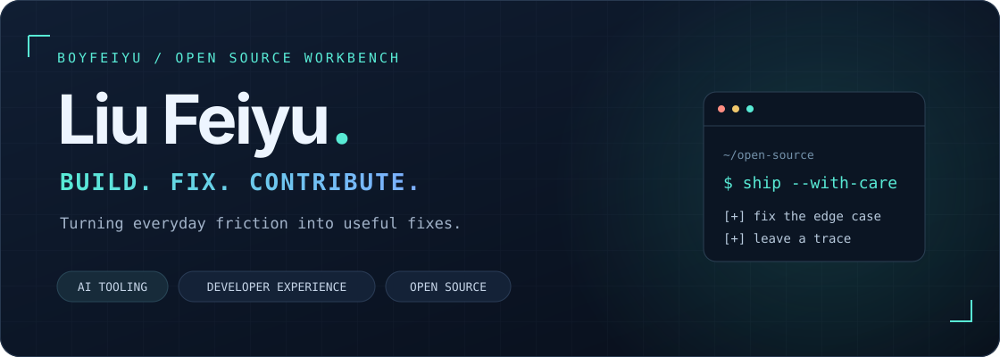
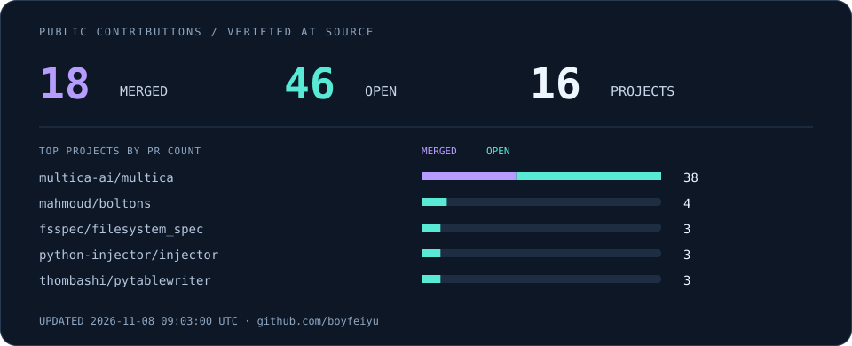

  

  <a href="https://github.com/boyfeiyu?tab=repositories">项目 / Repositories</a> ·
  <a href="#开源贡献--open-source">开源贡献 / Contributions</a> ·
  <a href="https://github.com/boyfeiyu/boyfeiyu/actions/workflows/main.yml">每日刷新 / Actions</a>

Hi，我是 **沙雕的小飞鱼儿 / Liu Feiyu** 👋

喜欢写代码，也爱折腾各种工具。这里放着我的项目和一些开源贡献，欢迎随便逛逛。

🎓 西北农林科技大学 · 计算机本科（2020–2024）

💼 目前在美团基础研发平台工作

### 开源贡献 / Open source

<!-- CONTRIBUTIONS:START -->

[我提过的 PR →](docs/contributions.md)

<!-- CONTRIBUTIONS:END -->

### 贡献日历 / Contribution graph

<picture>
  <source media="(prefers-color-scheme: dark)" srcset="https://raw.githubusercontent.com/boyfeiyu/boyfeiyu/output/github-contribution-grid-snake-dark.svg" />
  <source media="(prefers-color-scheme: light)" srcset="https://raw.githubusercontent.com/boyfeiyu/boyfeiyu/output/github-contribution-grid-snake.svg" />
  
</picture>
